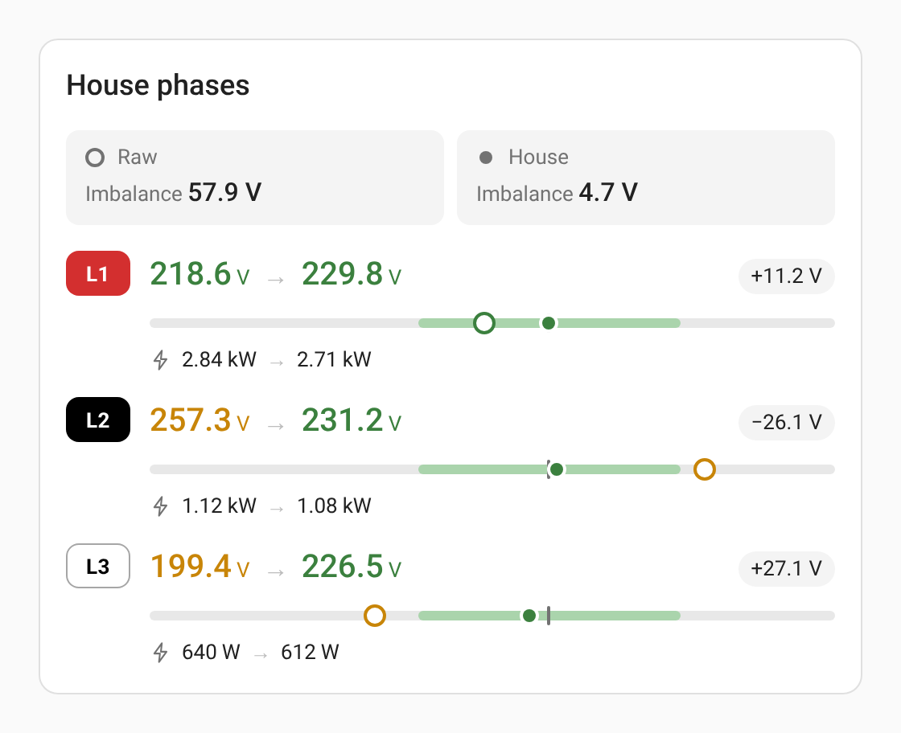
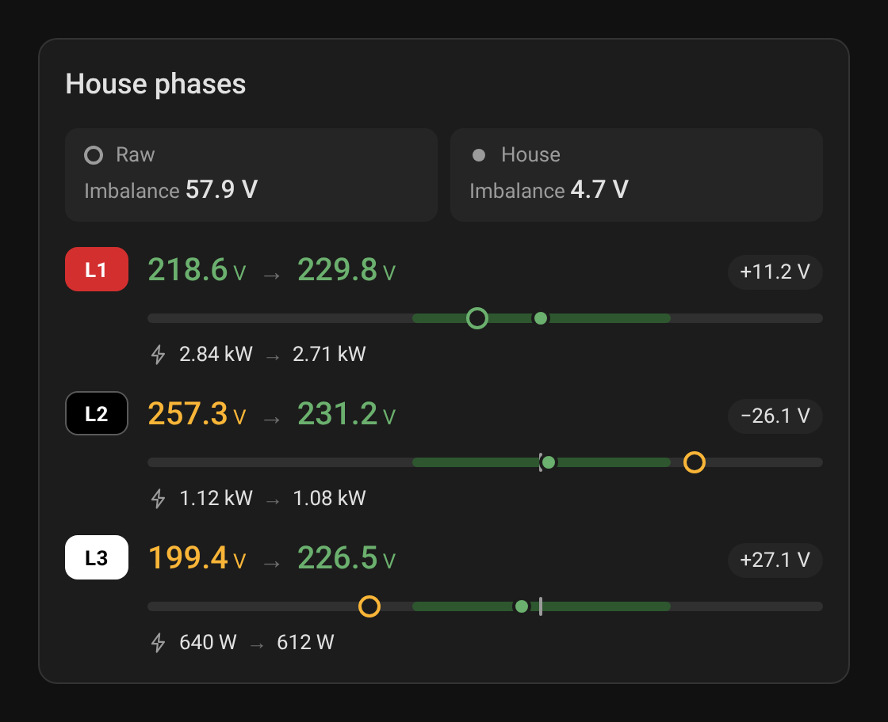
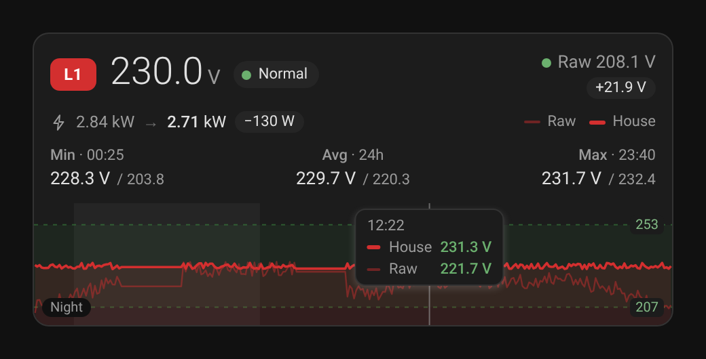
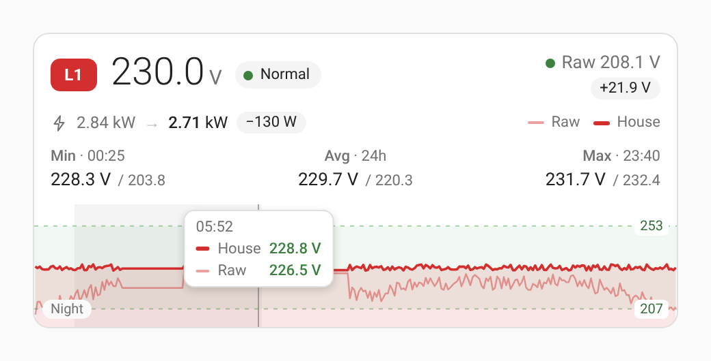
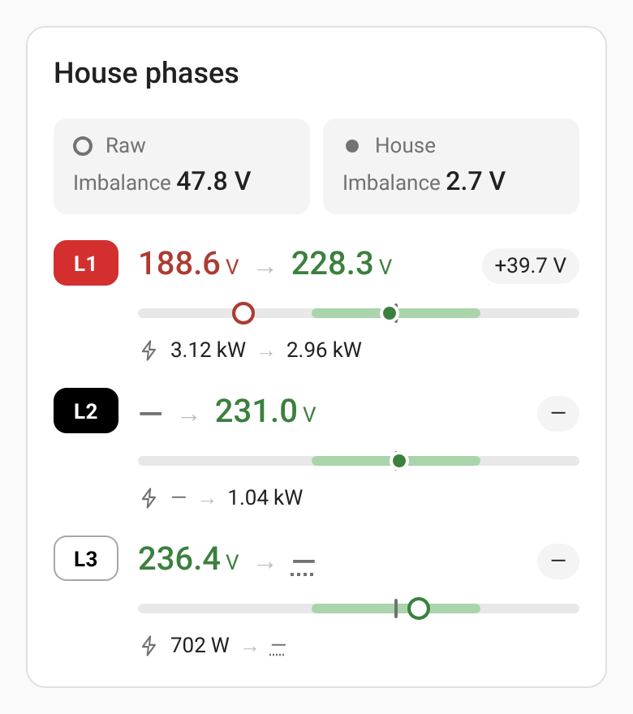
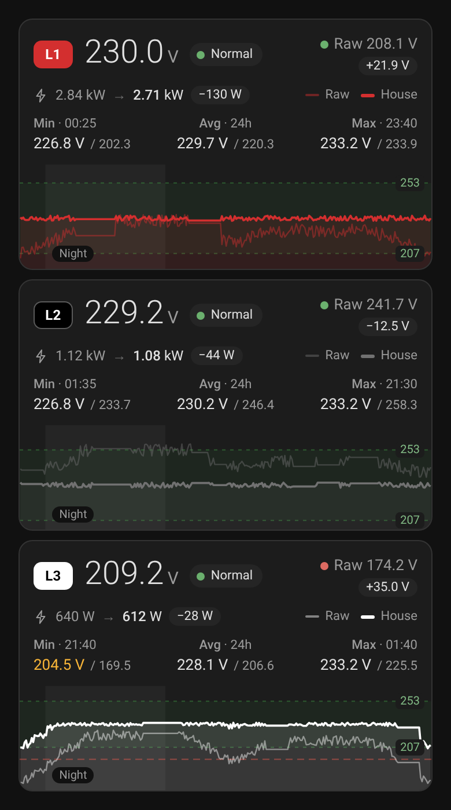
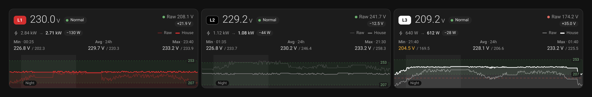
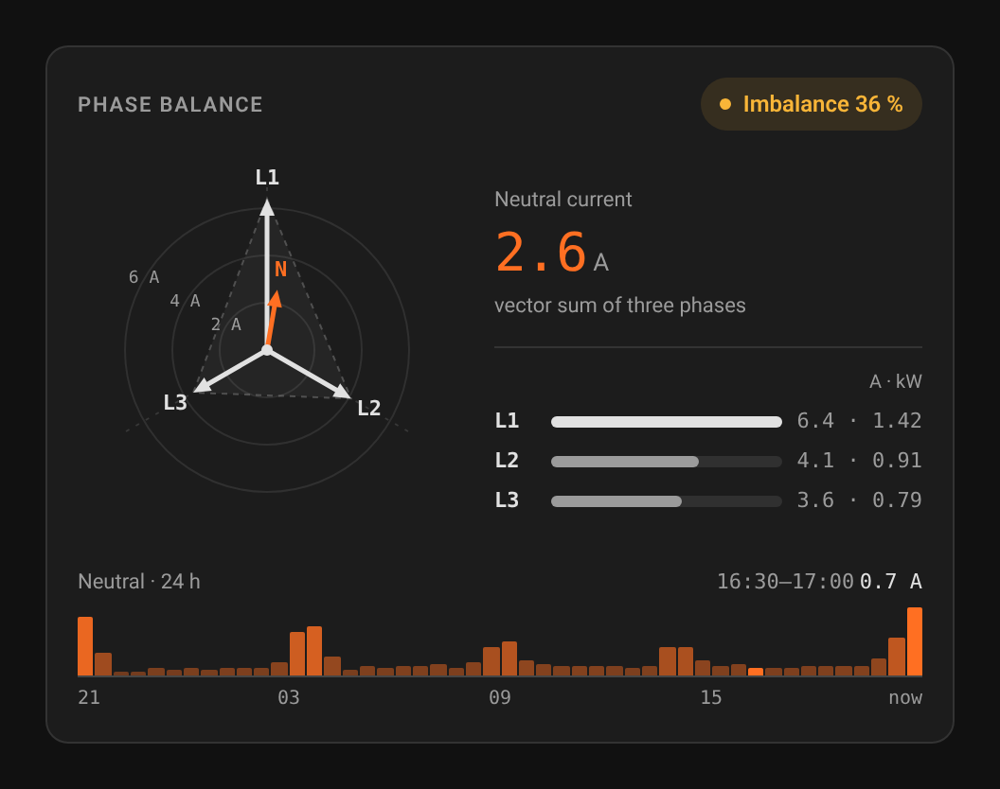
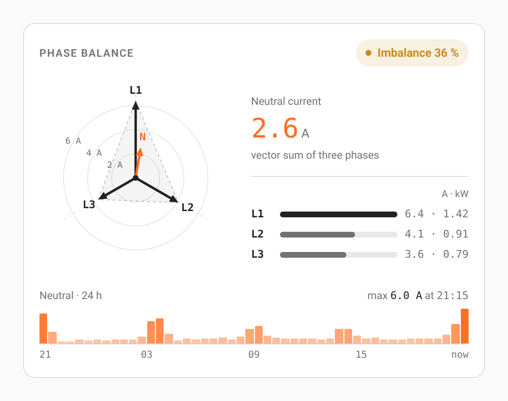

# Phase Pair Card

[](https://hacs.xyz/docs/faq/custom_repositories)
[](https://github.com/RobinCK/lovelace-phase-pair-card/releases/latest)
[](https://github.com/RobinCK/lovelace-phase-pair-card/actions/workflows/ci.yml)

A Home Assistant Lovelace card for three-phase homes that shows every phase as a **before → after** pair: voltage and power at the grid input (before the voltage stabilizers) next to the values the house actually receives. A phase balance view adds the current phasor diagram and the neutral current.

It is built for setups with energy meters on both sides of the stabilizers, for example Zigbee meters with current clamps where `zig_meter_raw` measures the input and `zig_meter_house` measures the house after all switches.

| All phases — light                              | All phases — dark                             |
| ----------------------------------------------- | --------------------------------------------- |
|  |  |

| Single phase with history chart                    | Single phase — light                                 |
| -------------------------------------------------- | ---------------------------------------------------- |
|  |  |

| Phone — unavailable and missing sensors           | Phone — three phases with charts                     |
| ------------------------------------------------- | ---------------------------------------------------- |
|  |  |



| Phase balance — dark                                 | Phase balance — light                                  |
| ---------------------------------------------------- | ------------------------------------------------------ |
|  |  |

## Features

- One row per phase: colored phase badge, voltage before → after, signed difference (after − before) and power before → after.
- Horizontal voltage scale with the normal range highlighted, a nominal tick and two markers: a ring for "before" and a dot for "after".
- Voltage values are colored by thresholds: normal, warning (outside the normal range) and critical (outside the critical range).
- Phase imbalance in the header: max − min voltage across phases, separately for "before" and "after".
- **Phase balance** view: current phasor diagram, neutral current as the vector sum of the phase currents, current imbalance, per-phase current and power, and a 24-hour neutral current histogram.
- **Single phase** view with a history chart: normal band, critical thresholds, night shading, min / average / max with timestamps and a hover tooltip. Several phases in one card are placed side by side when there is room and stacked on narrow screens.
- Every value is clickable and opens the Home Assistant more-info dialog of its entity; clicking the chart opens the history of the "after" voltage.
- Handles `unavailable`, `unknown`, missing entities and non-numeric states without breaking the layout.
- Uses only Home Assistant theme variables, so it follows light, dark and custom themes.
- Adapts to phone widths and supports the sections dashboard grid.
- Visual editor with entity pickers for every phase, thresholds and labels.
- Human-readable configuration errors.

## Installation

### HACS (recommended)

[](https://my.home-assistant.io/redirect/hacs_repository/?owner=RobinCK&repository=lovelace-phase-pair-card&category=plugin)

Or add it manually:

1. Open **HACS** in Home Assistant.
2. Open the menu in the top right corner and choose **Custom repositories**.
3. Add `https://github.com/RobinCK/lovelace-phase-pair-card` with the type **Dashboard**.
4. Search for **Phase Pair Card** and click **Download**.
5. Reload the browser page (clear the cache if the card is not found).

HACS registers the dashboard resource automatically.

### Manual

1. Download `phase-pair-card.js` from the [latest release](https://github.com/RobinCK/lovelace-phase-pair-card/releases/latest).
2. Copy it to `<config>/www/phase-pair-card.js`.
3. Go to **Settings → Dashboards → ⋮ → Resources** and add a resource:
   - URL: `/local/phase-pair-card.js?v=1.1.0`
   - Type: **JavaScript module**

   If your dashboards are in YAML mode, add it to `configuration.yaml` instead:

   ```yaml
   lovelace:
     resources:
       - url: /local/phase-pair-card.js?v=1.1.0
         type: module
   ```

4. Reload the browser page.

## Updating

- **HACS** shows an update as soon as a new release is published. Click **Update** and reload the browser page.
- **Manual**: replace `phase-pair-card.js` with the file from the new release and bump the `?v=` query in the resource URL so browsers drop the cached copy.

The browser console prints the loaded version (`PHASE-PAIR-CARD v1.1.0`), which is handy to confirm an update.

## Configuration

Add the card from the card picker (search for **Phase Pair Card**) and configure it in the visual editor, or use YAML:

```yaml
type: custom:phase-pair-card
title: House phases
before_label: Before stabilizers
after_label: House
phases:
  - name: L1
    color: '#d32f2f'
    before:
      voltage: sensor.zig_meter_raw_l1_voltage
      power: sensor.zig_meter_raw_l1_power
    after:
      voltage: sensor.zig_meter_house_l1_voltage
      power: sensor.zig_meter_house_l1_power
  - name: L2
    color: '#000000'
    before:
      voltage: sensor.zig_meter_raw_l2_voltage
      power: sensor.zig_meter_raw_l2_power
    after:
      voltage: sensor.zig_meter_house_l2_voltage
      power: sensor.zig_meter_house_l2_power
  - name: L3
    color: '#ffffff'
    before:
      voltage: sensor.zig_meter_raw_l3_voltage
      power: sensor.zig_meter_raw_l3_power
    after:
      voltage: sensor.zig_meter_house_l3_voltage
      power: sensor.zig_meter_house_l3_power
voltage:
  nominal: 230
  normal: [207, 253]
  critical: [195, 264]
  scale: [160, 280]
show_power: true
show_delta: true
show_imbalance: true
```

### Card options

| Option            | Type                           | Default   | Description                                                                                                                                                                                                                                                       |
| ----------------- | ------------------------------ | --------- | ----------------------------------------------------------------------------------------------------------------------------------------------------------------------------------------------------------------------------------------------------------------- |
| `type`            | string                         | —         | `custom:phase-pair-card`                                                                                                                                                                                                                                          |
| `title`           | string                         | —         | Card title.                                                                                                                                                                                                                                                       |
| `view`            | `all` \| `single` \| `balance` | `all`     | `all` shows compact rows with a voltage scale; `single` shows a detailed panel with a history chart for every phase, side by side when the card is wide enough; `balance` shows the phase balance of the currents, see [Phase balance view](#phase-balance-view). |
| `before_label`    | string                         | `Before`  | Name of the "before" side, for example the grid input before the stabilizers.                                                                                                                                                                                     |
| `after_label`     | string                         | `After`   | Name of the "after" side, for example the house.                                                                                                                                                                                                                  |
| `phases`          | list                           | required  | Phases to show, see [Phase options](#phase-options).                                                                                                                                                                                                              |
| `voltage`         | object                         | see below | Voltage thresholds, see [Voltage options](#voltage-options).                                                                                                                                                                                                      |
| `show_power`      | boolean                        | `true`    | Show power before → after for phases that have power sensors.                                                                                                                                                                                                     |
| `show_delta`      | boolean                        | `true`    | Show the difference after − before.                                                                                                                                                                                                                               |
| `show_imbalance`  | boolean                        | `true`    | `all` view: show the phase imbalance (max − min voltage) for both sides.                                                                                                                                                                                          |
| `show_before`     | boolean                        | `true`    | `single` view: show the "before" value, line and statistics.                                                                                                                                                                                                      |
| `hours_to_show`   | number                         | `24`      | `single` and `balance` views: history length in hours, from 1 to 168.                                                                                                                                                                                             |
| `highlight_night` | boolean                        | `true`    | `single` view: shade the night hours (23:00–06:00) on the chart.                                                                                                                                                                                                  |
| `side`            | `before` \| `after`            | `after`   | `balance` view: which sensors of every phase to use.                                                                                                                                                                                                              |
| `imbalance`       | object                         | see below | `balance` view: imbalance thresholds, see [Imbalance options](#imbalance-options).                                                                                                                                                                                |

### Phase options

| Option           | Type      | Default                         | Description                                                        |
| ---------------- | --------- | ------------------------------- | ------------------------------------------------------------------ |
| `name`           | string    | `L1`, `L2`, `L3`, …             | Text in the phase badge.                                           |
| `color`          | hex color | `#d32f2f`, `#000000`, `#ffffff` | Badge and chart color, e.g. `"#d32f2f"`.                           |
| `before.voltage` | entity    | —                               | Voltage sensor before the stabilizers.                             |
| `before.power`   | entity    | —                               | Power sensor before the stabilizers.                               |
| `after.voltage`  | entity    | —                               | Voltage sensor after the stabilizers.                              |
| `after.power`    | entity    | —                               | Power sensor after the stabilizers.                                |
| `before.current` | entity    | —                               | Current sensor before the stabilizers, used by the `balance` view. |
| `after.current`  | entity    | —                               | Current sensor after the stabilizers, used by the `balance` view.  |

Every sensor is optional, so a phase can show only the values you have. The power row is hidden for a phase without power sensors.

### Voltage options

| Option     | Type         | Default      | Description                                                                   |
| ---------- | ------------ | ------------ | ----------------------------------------------------------------------------- |
| `nominal`  | number       | `230`        | Nominal voltage, drawn as a tick on the scale.                                |
| `normal`   | `[min, max]` | `[207, 253]` | Normal range. Values outside it are a warning.                                |
| `critical` | `[min, max]` | `[195, 264]` | Critical thresholds. Values outside them are critical. Must contain `normal`. |
| `scale`    | `[min, max]` | `[160, 280]` | Range of the horizontal scale in the `all` view.                              |

Bounds are inclusive: with the defaults, `207 V` and `253 V` are normal, `195 V` and `264 V` are a warning, `194.9 V` is critical.

### Imbalance options

| Option     | Type   | Default | Description                                                  |
| ---------- | ------ | ------- | ------------------------------------------------------------ |
| `warning`  | number | `20`    | Imbalance in percent from which the badge shows a warning.   |
| `critical` | number | `50`    | Imbalance in percent from which the badge shows it critical. |

## Behaviour

### Colors

| State    | Condition                           | Color source      |
| -------- | ----------------------------------- | ----------------- |
| Normal   | inside `normal`                     | `--success-color` |
| Warning  | outside `normal`, inside `critical` | `--warning-color` |
| Critical | outside `critical`                  | `--error-color`   |

The card reads only Home Assistant theme variables (`--primary-text-color`, `--secondary-text-color`, `--card-background-color`, `--divider-color`, `--success-color`, `--warning-color`, `--error-color` and a few more), so it follows the light, dark and custom themes. A phase color that blends into the card background (white in a light theme, black in a dark theme) gets an outline on the badge, and its chart line uses the text color.

### Unavailable and missing sensors

| Sensor state             | Shown as                    | Clickable |
| ------------------------ | --------------------------- | --------- |
| `unavailable`, `unknown` | `—`                         | yes       |
| non-numeric state        | `—`                         | yes       |
| entity not found         | `—` with a dotted underline | no        |
| not configured           | `—`                         | no        |

Hover a value to see the side, the entity id and the reason. Differences and imbalance are calculated only from available values.

### Units

Power sensors in `mW`, `W`, `kW` or `MW`, voltage sensors in `mV`, `V` or `kV` and current sensors in `mA`, `A` or `kA` are converted automatically. Power is shown in watts below 1 kW and in kilowatts from 1 kW.

### Interactions

- Click any voltage, power or current value to open its more-info dialog.
- In the `single` view, move the pointer over the chart (or drag a finger on a touch screen) to see the time and both voltages at that moment. Click the chart to open the history of the "after" voltage.
- In the `balance` view, move the pointer over the neutral histogram to see the current of each half-hour.

### History chart

The `single` view shows the last `hours_to_show` hours and refreshes every five minutes. It reads the recorder's 5-minute statistics, which every sensor with `state_class: measurement` has, so even sensors that report every second load quickly. The few minutes not yet in the statistics and sensors without statistics are read from the state history.

The chart averages the values over time, leaves gaps where a sensor was unavailable and shows the minimum and maximum with the time they happened. Night hours (23:00–06:00 in your local time) are shaded and labelled.

### Phase balance view

The `balance` view needs exactly three phases with current sensors on the side chosen with `side`.

- **Phasor diagram.** Every phase current is drawn as an arrow, 120° apart: L1 up, L2 to the lower right, L3 to the lower left. The rings mark round current steps and the dashed triangle joins the arrow tips.
- **Neutral current.** The orange arrow and the large value are the vector sum of the three phase currents. It is an estimate that assumes the phases are 120° apart and each current is in phase with its voltage, which is close for most household loads. With a balanced load it is zero; with one loaded phase it equals that phase current.
- **Imbalance.** The badge shows the largest deviation of a phase current from the average of the three, in percent of that average. It is a warning from `imbalance.warning` and critical from `imbalance.critical`.
- **Phase rows.** Current in A and power in kW of every phase. The bar of the most loaded phase is highlighted.
- **Neutral history.** The neutral current every half-hour over `hours_to_show` hours, calculated from the phase current statistics, with its maximum and the time it happened.

## Examples

### Compact card for all phases

```yaml
type: custom:phase-pair-card
title: Phases
before_label: Grid
after_label: House
phases:
  - name: L1
    before: { voltage: sensor.grid_l1_voltage }
    after: { voltage: sensor.house_l1_voltage }
  - name: L2
    before: { voltage: sensor.grid_l2_voltage }
    after: { voltage: sensor.house_l2_voltage }
  - name: L3
    before: { voltage: sensor.grid_l3_voltage }
    after: { voltage: sensor.house_l3_voltage }
```

### Three phases with charts side by side

```yaml
type: custom:phase-pair-card
view: single
before_label: Grid
after_label: House
hours_to_show: 12
phases:
  - name: L1
    color: '#d32f2f'
    before: { voltage: sensor.grid_l1_voltage, power: sensor.grid_l1_power }
    after: { voltage: sensor.house_l1_voltage, power: sensor.house_l1_power }
  - name: L2
    color: '#000000'
    before: { voltage: sensor.grid_l2_voltage, power: sensor.grid_l2_power }
    after: { voltage: sensor.house_l2_voltage, power: sensor.house_l2_power }
  - name: L3
    color: '#ffffff'
    before: { voltage: sensor.grid_l3_voltage, power: sensor.grid_l3_power }
    after: { voltage: sensor.house_l3_voltage, power: sensor.house_l3_power }
grid_options:
  columns: full
```

The phases share one row when every phase gets at least 300 px, two per row on medium widths (an odd last phase takes the whole row) and one per row on phones. In a sections dashboard, put the card in a wide section (section width 3 or 4, or `column_span` in YAML) and keep `columns: full` so the card follows the section width on every screen.

### Phase balance of the house

```yaml
type: custom:phase-pair-card
view: balance
side: after
phases:
  - name: L1
    after:
      current: sensor.house_l1_current
      power: sensor.house_l1_power
  - name: L2
    after:
      current: sensor.house_l2_current
      power: sensor.house_l2_power
  - name: L3
    after:
      current: sensor.house_l3_current
      power: sensor.house_l3_power
imbalance:
  warning: 20
  critical: 50
```

### Stricter thresholds for sensitive equipment

```yaml
type: custom:phase-pair-card
phases:
  - name: L1
    before: { voltage: sensor.grid_l1_voltage }
    after: { voltage: sensor.house_l1_voltage }
voltage:
  nominal: 230
  normal: [220, 240]
  critical: [210, 250]
  scale: [180, 270]
show_imbalance: false
```

## Development

Requirements: Node.js 22.

```bash
npm ci
```

```bash
npm run build
```

The bundle is written to `dist/phase-pair-card.js`.

```bash
npm test
```

```bash
npm run lint
```

```bash
npm run typecheck
```

### Releasing

1. Bump `version` in `package.json` (and the `?v=` example in this README).
2. Push to `main`.

The **Release** workflow builds the card, runs the checks and publishes a GitHub release `vX.Y.Z` with `phase-pair-card.js` attached. HACS picks up the new release automatically.

## Other Home Assistant projects

- [Blackout](https://github.com/RobinCK/blackout) — integration for planned and emergency power outages in Ukraine: schedules for 21 regions, the Ukrenergo grid state, outage history and dashboard cards.
- [Sirio Pump Inverter (WiNET)](https://github.com/RobinCK/ha-sirio-winet) — local integration for Italtecnica Sirio pump inverters with the WiNET Wi-Fi module, with a pressure gauge card.
- [Klimo](https://github.com/RobinCK/klimo) — add-on for room-by-room heating and cooling: heat pumps, boilers, air conditioners, heaters and circulation pumps.
- [Zroshua](https://github.com/RobinCK/zroshua) — add-on for smart irrigation: zones, schedules, weather, rain and soil sensors and a live site map.
- [Metron](https://github.com/RobinCK/lovelace-metron) — Lovelace cards for energy, solar, battery, gas and money: live flows, statistics, forecasts and bills.
- [Varta](https://github.com/RobinCK/lovelace-varta) — Lovelace cards that keep watch over the house: offline devices grouped by hub or integration, and batteries with a replacement forecast.
- [Deye Inverter Card](https://github.com/RobinCK/lovelace-deye-inverter-card) — Lovelace card with the state and live values of Deye/Sunsynk hybrid inverters.
- [Deck Card](https://github.com/RobinCK/lovelace-deck-card) — adaptive container card that groups cards into segments: pills on wide screens, swipe on phones.
- [Osnova](https://github.com/RobinCK/osnova) — theme for the whole Home Assistant interface with a Ukrainian cross-stitch ornament.
- [Solax2HA](https://github.com/RobinCK/solax2ha) — service that sends Solax inverter data to Home Assistant sensors.

## License

[MIT](LICENSE) © Igor Ognichenko
